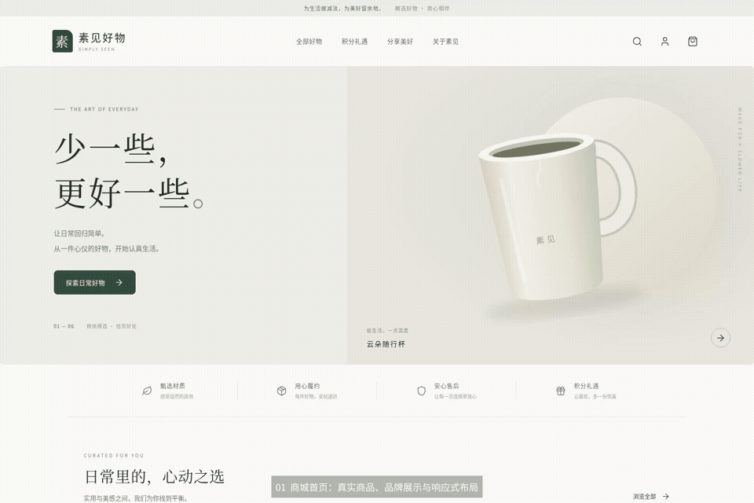
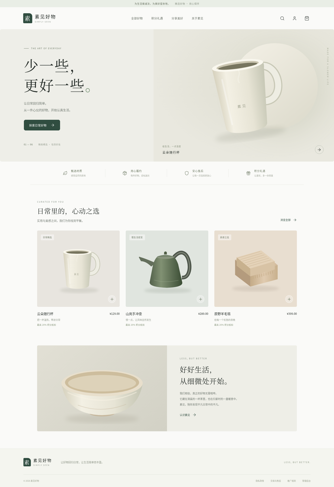
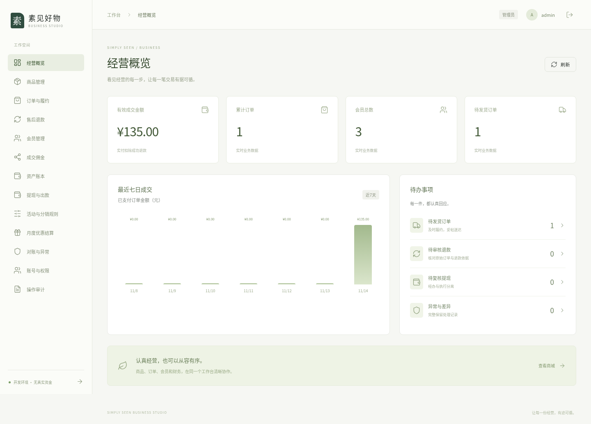
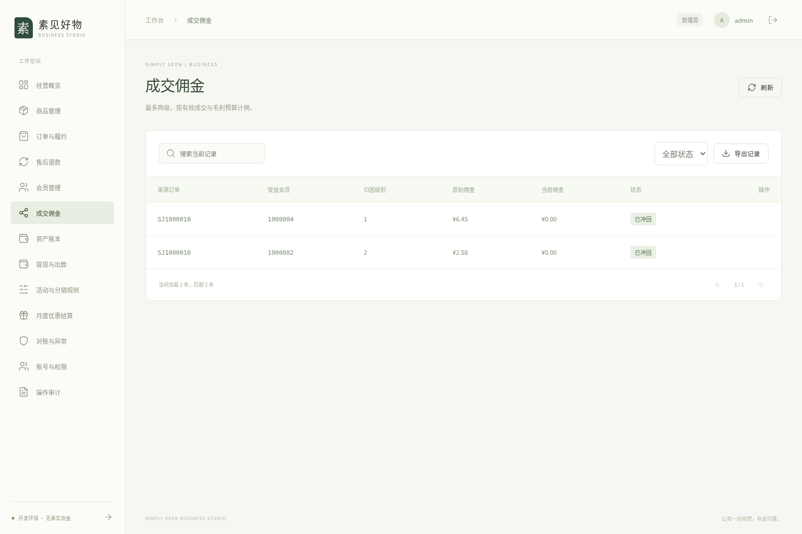

# 素见好物 · 实际操作演示

本次演示操作实际 Chromium 浏览器，连接项目本地前后端，没有拦截或模拟业务API响应。支付、退款为明确标记的开发测试，不发生真实资金交易。

- [下载完整录像（约92秒，MP4，带中文步骤字幕）](https://github.com/mrsong123/simply-seen/raw/refs/heads/main/docs/demo/simply-seen-demo.mp4)
- [下载离线演示页（单文件，内含录像、章节跳转和截图）](https://github.com/mrsong123/simply-seen/raw/refs/heads/main/docs/demo/simply-seen-demo.html)：下载后用浏览器打开即可观看。

仓库为私有时，需要先登录有访问权限的GitHub账号。录像已删除等待片段，未录制管理员口令。最终MP4全文件解码通过；同一单文件播放器已通过本地HTTP服务在浏览器中验证播放和章节跳转。当前受管浏览器禁止file协议，因此没有在该浏览器验证直接打开本地HTML文件。

## 本次实际流程

| 环节 | 操作及结果 |
|---|---|
| 商城 | 首页、分类、香氛搜索、商品详情、购物袋、地址与结算 |
| 订单 | 129元商品加6元运费，创建135元订单，开发付款后进入待发货 |
| 二级分销 | 真实注册两级邀请链，当前订单分别生成6.45元、2.58元待结算佣金 |
| 后台履约 | 管理员录入演示物流单，买家查看并确认收货 |
| 售后 | 买家申请退款，管理员记录审核依据并批准，订单进入已退款 |
| 佣金冲回 | 全额退款后，两级佣金当前金额归零，状态均为已冲回 |
| 财务与数据 | 执行账本对账，实际导出商品CSV |
| 手机布局 | 390px浏览器视口截图，无横向溢出；这不是微信真机验收 |

## 页面截图

### 商城首页

### 运营后台

### 订单产生的两级佣金

### 退款后的佣金冲回

[查看手机布局截图](16-mobile.png)
